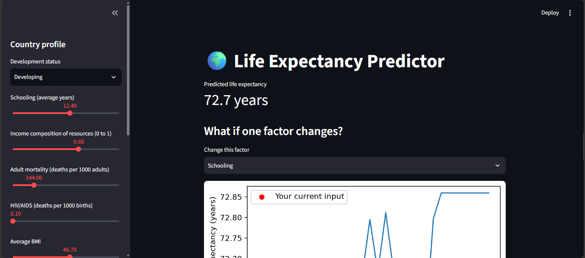
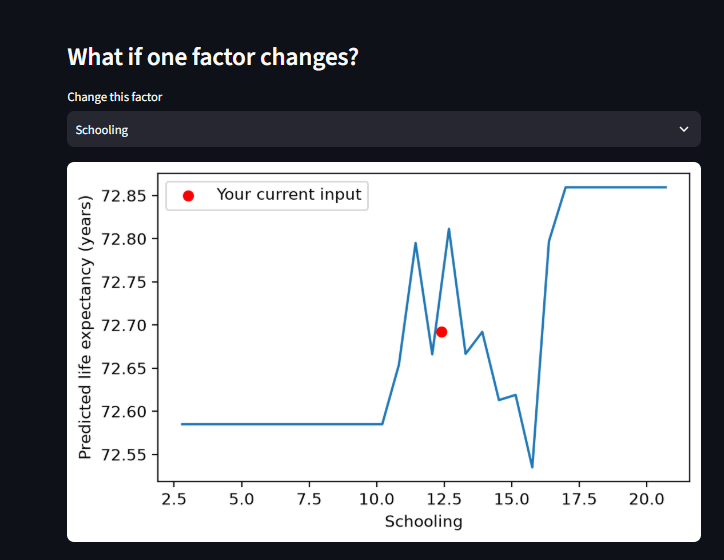
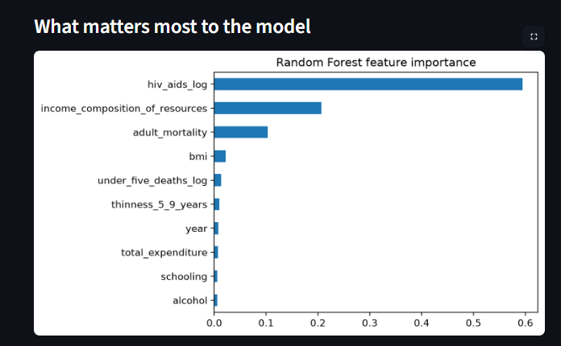

# Life Expectancy Predictor

A machine learning project that predicts a country's average life expectancy from health, education and economic indicators, with a Streamlit web app so anyone can try it.

**Type:** supervised learning, regression
**Data:** WHO country data (2000 to 2015) from Kaggle
**Models compared:** Linear Regression, Random Forest, KNN, SVR

---

## Screenshots


**App home screen**



**What-if chart**



**What matters most**



---

## How it works

1. **Clean** the raw WHO data: fix column names, fill gaps using each country's own other years, drop the population column, and treat placeholder zeros as missing.
2. **Explore** the data with charts (correlation heatmap, trends, developed vs developing countries).
3. **Engineer features:** encode status as 0/1, create an average vaccination feature, and log-transform skewed columns.
4. **Split by country** so the test set only has countries the model has never seen (a random split would leak information, because each country appears 16 times).
5. **Train and compare** four models inside scikit-learn pipelines (median imputation, scaling, model), using MAE, RMSE, R² and 5-fold cross-validation.
6. **Save** the best model with joblib and load it in the Streamlit app.

## Results

| Model | MAE (years) | RMSE (years) | R² | CV R² |
|---|---|---|---|---|
| Linear Regression |2.666 |3.46 |0.872 |0.848 |
| Random Forest |2.011 |2.759 |0.919 |0.905 |
| KNN |3.099 |3.907 |0.837 |0.829 |
| SVR |2.197 |2.872 |0.912 |0.893 |

**Selected model:** Random Forest

## Project structure

```
life-expectancy-project/
├── Life Expectancy Data.csv        raw data 
├── life_expectancy_cleaned.csv     cleaned dataset
├── project.ipynb                   cleaning, EDA, feature engineering, models
├── life_expectancy_model.joblib    saved best model (created by the notebook)
├── model_results.csv               comparison table (created by the notebook)
├── app.py                          Streamlit app
├── requirements.txt                libraries needed
├── screenshots                     images used in this README
└── README.md
```

## How to run

1. Install the libraries:
   ```bash
   pip install -r requirements.txt
   ```
2. Put the dataset CSV in the project folder.
3. Open `project.ipynb` and choose **Run All**. This trains the models and creates `life_expectancy_model.joblib`.
4. Start the app:
   ```bash
   streamlit run app.py
   ```
   If the `streamlit` command is not found, use `python -m streamlit run app.py`.

## Data

Life Expectancy (WHO), Kaggle (uploader: kumarajarshi): https://www.kaggle.com/datasets/kumarajarshi/life-expectancy-who

About 2,938 rows and 22 columns. 

## Limitations

- Country-level data from 2000 to 2015: it estimates a country's average life expectancy, not an individual's lifespan.
- It is a prediction model, not a forecasting model. Inputs outside the training range give unreliable results.
- The model cannot predict above the highest value in the training data (about 89 years).
- Results show associations in the data, not cause and effect.

## Tools

Python, pandas, NumPy, Matplotlib, Seaborn, scikit-learn, joblib, Streamlit, Jupyter, VS Code.

## Author

Sushan Shrestha, Data Science course, Broadway Infosys


